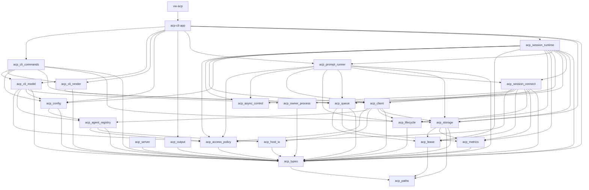

# ACP 分包说明

本轮仅完成迁移与静态审阅；未编译、未测试、未实机验收。Cargo.lock 本轮未更新，新增包锁定及 `--locked` CI 均未验收。静态清单不证明可编译。

## 入口与唯一归属

`vw-acp` 是兼容导出门面；`src/main.rs` 设置 Tokio 运行环境并调用 `acp-cli-app::run`。`src/version.rs` 仅传入原入口包元数据，解析和缓存由 `acp-cli-model` 唯一持有。

下表以首次路径拆包前提交 `92e678c46^` 的 `crates/vw-acp/src/` 为基线，包含生产、测试和内嵌资源；右列为仓库根相对路径。新建的包根仅组织本包模块，不复制业务实现。

| 原 src/ 相对路径 | 唯一归属路径 |
| --- | --- |
| `access_policy.rs` | `crates/libs/acp-access-policy/src/access_policy.rs` |
| `access_policy/claude.rs` | `crates/libs/acp-access-policy/src/access_policy/claude.rs` |
| `access_policy/claude_fallback_acceptance.rs` | `crates/libs/acp-client/src/client/claude_fallback_acceptance.rs` |
| `access_policy/claude_tests.rs` | `crates/libs/acp-client/src/client/claude_tests.rs` |
| `access_policy/codebuddy.rs` | `crates/libs/acp-access-policy/src/access_policy/codebuddy.rs` |
| `access_policy/codex.rs` | `crates/libs/acp-access-policy/src/access_policy/codex.rs` |
| `access_policy/codex_tests.rs` | `crates/libs/acp-client/src/client/codex_tests.rs` |
| `access_policy/copilot.rs` | `crates/libs/acp-access-policy/src/access_policy/copilot.rs` |
| `access_policy/cursor.rs` | `crates/libs/acp-access-policy/src/access_policy/cursor.rs` |
| `access_policy/droid.rs` | `crates/libs/acp-access-policy/src/access_policy/droid.rs` |
| `access_policy/gemini.rs` | `crates/libs/acp-access-policy/src/access_policy/gemini.rs` |
| `access_policy/gemini_tests.rs` | `crates/libs/acp-client/src/client/gemini_tests.rs` |
| `access_policy/goose.rs` | `crates/libs/acp-access-policy/src/access_policy/goose.rs` |
| `access_policy/goose_tests.rs` | `crates/libs/acp-access-policy/src/access_policy/goose_tests.rs` |
| `access_policy/hermes.rs` | `crates/libs/acp-access-policy/src/access_policy/hermes.rs` |
| `access_policy/iflow.rs` | `crates/libs/acp-access-policy/src/access_policy/iflow.rs` |
| `access_policy/kimi.rs` | `crates/libs/acp-access-policy/src/access_policy/kimi.rs` |
| `access_policy/kiro.rs` | `crates/libs/acp-access-policy/src/access_policy/kiro.rs` |
| `access_policy/opencode.rs` | `crates/libs/acp-access-policy/src/access_policy/opencode.rs` |
| `access_policy/qoder.rs` | `crates/libs/acp-access-policy/src/access_policy/qoder.rs` |
| `access_policy/qwen.rs` | `crates/libs/acp-access-policy/src/access_policy/qwen.rs` |
| `access_policy/qwen_tests.rs` | `crates/libs/acp-client/src/client/qwen_tests.rs` |
| `access_policy/vibe.rs` | `crates/libs/acp-access-policy/src/access_policy/vibe.rs` |
| `access_policy_tests.rs` | `crates/vw-acp/src/access_policy_tests.rs` |
| `acp_error_shapes.rs` | `crates/libs/acp-types/src/acp_error_shapes.rs` |
| `acp_error_shapes_tests.rs` | `crates/libs/acp-types/src/acp_error_shapes_tests.rs` |
| `acp_jsonrpc.rs` | `crates/libs/acp-types/src/acp_jsonrpc.rs` |
| `acp_jsonrpc_tests.rs` | `crates/libs/acp-types/src/acp_jsonrpc_tests.rs` |
| `agent_registry.rs` | `crates/libs/acp-agent-registry/src/agent_registry.rs` |
| `agent_registry_tests.rs` | `crates/libs/acp-agent-registry/src/agent_registry_tests.rs` |
| `agent_session_id.rs` | `crates/libs/acp-types/src/agent_session_id.rs` |
| `agent_session_id_tests.rs` | `crates/libs/acp-types/src/agent_session_id_tests.rs` |
| `cli/config_command.rs` | `crates/libs/acp-cli-commands/src/cli/config_command.rs` |
| `cli/config_command_tests.rs` | `crates/libs/acp-cli-commands/src/cli/config_command_tests.rs` |
| `cli/flags.rs` | `crates/libs/acp-cli-model/src/cli/flags.rs` |
| `cli/flags_tests.rs` | `crates/libs/acp-cli-model/src/cli/flags_tests.rs` |
| `cli/json_output.rs` | `crates/libs/acp-cli-render/src/cli/json_output.rs` |
| `cli/json_output_tests.rs` | `crates/libs/acp-cli-render/src/cli/json_output_tests.rs` |
| `cli/mod.rs` | `crates/libs/acp-cli-commands/src/cli/mod.rs` |
| `cli/output_render.rs` | `crates/libs/acp-cli-render/src/cli/output_render.rs` |
| `cli/output_render_tests.rs` | `crates/libs/acp-cli-render/src/cli/output_render_tests.rs` |
| `cli/session_target.rs` | `crates/libs/acp-cli-commands/src/cli/session_target.rs` |
| `cli/status_command.rs` | `crates/libs/acp-cli-commands/src/cli/status_command.rs` |
| `cli/status_command_tests.rs` | `crates/libs/acp-cli-commands/src/cli/status_command_tests.rs` |
| `cli_core.rs` | `crates/libs/acp-cli-model/src/cli_core.rs` |
| `cli_core_tests.rs` | `crates/libs/acp-cli-model/src/cli_core_tests.rs` |
| `cli_public.rs` | `crates/libs/acp-cli-model/src/cli_public.rs` |
| `cli_public_tests.rs` | `crates/libs/acp-cli-model/src/cli_public_tests.rs` |
| `client.rs` | `crates/libs/acp-client/src/client.rs` |
| `client/access_policy.rs` | `crates/libs/acp-client/src/client/access_policy.rs` |
| `client/access_policy_tests.rs` | `crates/libs/acp-client/src/client/access_policy_tests.rs` |
| `client/access_restore.rs` | `crates/libs/acp-client/src/client/access_restore.rs` |
| `client/active_prompt.rs` | `crates/libs/acp-client/src/client/active_prompt.rs` |
| `client/active_prompt_tests.rs` | `crates/libs/acp-client/src/client/active_prompt_tests.rs` |
| `client/actor.rs` | `crates/libs/acp-client/src/client/actor.rs` |
| `client/actor_handle.rs` | `crates/libs/acp-client/src/client/actor_handle.rs` |
| `client/actor_handle_tests.rs` | `crates/libs/acp-client/src/client/actor_handle_tests.rs` |
| `client/actor_tests.rs` | `crates/libs/acp-client/src/client/actor_tests.rs` |
| `client/auth.rs` | `crates/libs/acp-client/src/client/auth.rs` |
| `client/auth_env.rs` | `crates/libs/acp-client/src/client/auth_env.rs` |
| `client/auth_env_tests.rs` | `crates/libs/acp-client/src/client/auth_env_tests.rs` |
| `client/auth_tests.rs` | `crates/libs/acp-client/src/client/auth_tests.rs` |
| `client/builder.rs` | `crates/libs/acp-client/src/client/builder.rs` |
| `client/builder_tests.rs` | `crates/libs/acp-client/src/client/builder_tests.rs` |
| `client/client_error.rs` | `crates/libs/acp-client/src/client/client_error.rs` |
| `client/client_error_tests.rs` | `crates/libs/acp-client/src/client/client_error_tests.rs` |
| `client/codebuddy_access.rs` | `crates/libs/acp-client/src/client/codebuddy_access.rs` |
| `client/commands.rs` | `crates/libs/acp-client/src/client/commands.rs` |
| `client/commands_tests.rs` | `crates/libs/acp-client/src/client/commands_tests.rs` |
| `client/error_context.rs` | `crates/libs/acp-client/src/client/error_context.rs` |
| `client/error_context_tests.rs` | `crates/libs/acp-client/src/client/error_context_tests.rs` |
| `client/event_client.rs` | `crates/libs/acp-client/src/client/event_client.rs` |
| `client/event_client_tests.rs` | `crates/libs/acp-client/src/client/event_client_tests.rs` |
| `client/goose_access.rs` | `crates/libs/acp-client/src/client/goose_access.rs` |
| `client/helpers.rs` | `crates/libs/acp-client/src/client/helpers.rs` |
| `client/helpers_tests.rs` | `crates/libs/acp-client/src/client/helpers_tests.rs` |
| `client/hermes_access.rs` | `crates/libs/acp-client/src/client/hermes_access.rs` |
| `client/iflow_access.rs` | `crates/libs/acp-client/src/client/iflow_access.rs` |
| `client/kimi_access.rs` | `crates/libs/acp-client/src/client/kimi_access.rs` |
| `client/lifecycle.rs` | `crates/libs/acp-client/src/client/lifecycle.rs` |
| `client/lifecycle_tests.rs` | `crates/libs/acp-client/src/client/lifecycle_tests.rs` |
| `client/message_io.rs` | `crates/libs/acp-client/src/client/message_io.rs` |
| `client/message_io_tests.rs` | `crates/libs/acp-client/src/client/message_io_tests.rs` |
| `client/nova_io.rs` | `crates/libs/acp-client/src/client/nova_io.rs` |
| `client/process.rs` | `crates/libs/acp-client/src/client/process.rs` |
| `client/process_signals.rs` | `crates/libs/acp-client/src/client/process_signals.rs` |
| `client/process_signals_tests.rs` | `crates/libs/acp-client/src/client/process_signals_tests.rs` |
| `client/process_tests.rs` | `crates/libs/acp-client/src/client/process_tests.rs` |
| `client/prompt_controls.rs` | `crates/libs/acp-client/src/client/prompt_controls.rs` |
| `client/prompt_loop.rs` | `crates/libs/acp-client/src/client/prompt_loop.rs` |
| `client/prompt_loop_tests.rs` | `crates/libs/acp-client/src/client/prompt_loop_tests.rs` |
| `client/prompt_mapping.rs` | `crates/libs/acp-client/src/client/prompt_mapping.rs` |
| `client/prompt_mapping_tests.rs` | `crates/libs/acp-client/src/client/prompt_mapping_tests.rs` |
| `client/protocol.rs` | `crates/libs/acp-client/src/client/protocol.rs` |
| `client/protocol_tests.rs` | `crates/libs/acp-client/src/client/protocol_tests.rs` |
| `client/qoder_access.rs` | `crates/libs/acp-client/src/client/qoder_access.rs` |
| `client/runtime.rs` | `crates/libs/acp-client/src/client/runtime.rs` |
| `client/runtime_tests.rs` | `crates/libs/acp-client/src/client/runtime_tests.rs` |
| `client/session_control.rs` | `crates/libs/acp-client/src/client/session_control.rs` |
| `client/session_control_tests.rs` | `crates/libs/acp-client/src/client/session_control_tests.rs` |
| `client/session_meta.rs` | `crates/libs/acp-client/src/client/session_meta.rs` |
| `client/session_meta_tests.rs` | `crates/libs/acp-client/src/client/session_meta_tests.rs` |
| `client/state.rs` | `crates/libs/acp-client/src/client/state.rs` |
| `client/timeout_messages.rs` | `crates/libs/acp-client/src/client/timeout_messages.rs` |
| `client/timeout_messages_tests.rs` | `crates/libs/acp-client/src/client/timeout_messages_tests.rs` |
| `client/vibe_access.rs` | `crates/libs/acp-client/src/client/vibe_access.rs` |
| `client_tests.rs` | `crates/libs/acp-client/src/client_tests.rs` |
| `codex_compat.rs` | `crates/libs/acp-access-policy/src/codex_compat.rs` |
| `codex_compat_tests.rs` | `crates/libs/acp-access-policy/src/codex_compat_tests.rs` |
| `config.rs` | `crates/libs/acp-config/src/config.rs` |
| `config_tests.rs` | `crates/libs/acp-config/src/config_tests.rs` |
| `error.rs` | `crates/libs/acp-types/src/error.rs` |
| `error_normalization.rs` | `crates/libs/acp-types/src/error_normalization.rs` |
| `error_normalization_tests.rs` | `crates/libs/acp-types/src/error_normalization_tests.rs` |
| `error_tests.rs` | `crates/libs/acp-types/src/error_tests.rs` |
| `errors.rs` | `crates/libs/acp-types/src/errors.rs` |
| `errors_tests.rs` | `crates/libs/acp-types/src/errors_tests.rs` |
| `filesystem.rs` | `crates/libs/acp-host-io/src/filesystem.rs` |
| `filesystem/workspace_write.rs` | `crates/libs/acp-host-io/src/filesystem/workspace_write.rs` |
| `filesystem_tests.rs` | `crates/libs/acp-host-io/src/filesystem_tests.rs` |
| `install.rs` | `crates/libs/acp-agent-registry/src/install.rs` |
| `install_tests.rs` | `crates/libs/acp-agent-registry/src/install_tests.rs` |
| `jsonrpc_error.rs` | `crates/libs/acp-types/src/jsonrpc_error.rs` |
| `jsonrpc_error_tests.rs` | `crates/libs/acp-types/src/jsonrpc_error_tests.rs` |
| `lib.rs` | `crates/vw-acp/src/lib.rs` |
| `main.rs` | `crates/vw-acp/src/main.rs` |
| `main_tests.rs` | `crates/libs/acp-cli-app/src/main_tests.rs` |
| `managed_runtime.rs` | `crates/libs/acp-agent-registry/src/managed_runtime.rs` |
| `managed_runtime/contracts.json` | `crates/libs/acp-agent-registry/src/managed_runtime/contracts.json` |
| `managed_runtime/deepagents-lock.json` | `crates/libs/acp-agent-registry/src/managed_runtime/deepagents-lock.json` |
| `managed_runtime/iflow-lock.json` | `crates/libs/acp-agent-registry/src/managed_runtime/iflow-lock.json` |
| `managed_runtime/install.py` | `crates/libs/acp-agent-registry/src/managed_runtime/install.py` |
| `managed_runtime_tests.rs` | `crates/libs/acp-agent-registry/src/managed_runtime_tests.rs` |
| `mcp_servers.rs` | `crates/libs/acp-config/src/mcp_servers.rs` |
| `mcp_servers_tests.rs` | `crates/libs/acp-config/src/mcp_servers_tests.rs` |
| `output.rs` | `crates/libs/acp-output/src/output.rs` |
| `output_coverage_tests.rs` | `crates/libs/acp-output/src/output_coverage_tests.rs` |
| `output_json_formatter.rs` | `crates/libs/acp-output/src/output_json_formatter.rs` |
| `output_json_formatter_tests.rs` | `crates/libs/acp-output/src/output_json_formatter_tests.rs` |
| `output_tests.rs` | `crates/libs/acp-output/src/output_tests.rs` |
| `perf_metrics.rs` | `crates/libs/acp-metrics/src/perf_metrics.rs` |
| `perf_metrics_capture.rs` | `crates/libs/acp-metrics/src/perf_metrics_capture.rs` |
| `perf_metrics_capture_tests.rs` | `crates/libs/acp-metrics/src/perf_metrics_capture_tests.rs` |
| `perf_metrics_tests.rs` | `crates/libs/acp-metrics/src/perf_metrics_tests.rs` |
| `permission_prompt.rs` | `crates/libs/acp-host-io/src/permission_prompt.rs` |
| `permission_prompt_tests.rs` | `crates/libs/acp-host-io/src/permission_prompt_tests.rs` |
| `permissions.rs` | `crates/libs/acp-host-io/src/permissions.rs` |
| `permissions_tests.rs` | `crates/libs/acp-host-io/src/permissions_tests.rs` |
| `persisted_key_policy.rs` | `crates/libs/acp-storage/src/persisted_key_policy.rs` |
| `persisted_key_policy_tests.rs` | `crates/libs/acp-storage/src/persisted_key_policy_tests.rs` |
| `prompt_content.rs` | `crates/libs/acp-types/src/prompt_content.rs` |
| `prompt_content_tests.rs` | `crates/libs/acp-types/src/prompt_content_tests.rs` |
| `queue_ipc.rs` | `crates/libs/acp-queue/src/queue_ipc.rs` |
| `queue_ipc_health.rs` | `crates/libs/acp-queue/src/queue_ipc_health.rs` |
| `queue_ipc_health_tests.rs` | `crates/libs/acp-queue/src/queue_ipc_health_tests.rs` |
| `queue_ipc_server.rs` | `crates/libs/acp-queue/src/queue_ipc_server.rs` |
| `queue_ipc_server_tests.rs` | `crates/libs/acp-queue/src/queue_ipc_server_tests.rs` |
| `queue_ipc_tests.rs` | `crates/libs/acp-queue/src/queue_ipc_tests.rs` |
| `queue_ipc_transport.rs` | `crates/libs/acp-queue/src/queue_ipc_transport.rs` |
| `queue_ipc_transport_tests.rs` | `crates/libs/acp-queue/src/queue_ipc_transport_tests.rs` |
| `queue_lease_store.rs` | `crates/libs/acp-lease/src/queue_lease_store.rs` |
| `queue_lease_store_tests.rs` | `crates/libs/acp-lease/src/queue_lease_store_tests.rs` |
| `queue_messages.rs` | `crates/libs/acp-queue/src/queue_messages.rs` |
| `queue_messages_tests.rs` | `crates/libs/acp-queue/src/queue_messages_tests.rs` |
| `queue_owner_env.rs` | `crates/libs/acp-session-runtime/src/queue_owner_env.rs` |
| `queue_owner_env_tests.rs` | `crates/libs/acp-session-runtime/src/queue_owner_env_tests.rs` |
| `queue_owner_turn_controller.rs` | `crates/libs/acp-queue/src/queue_owner_turn_controller.rs` |
| `queue_owner_turn_controller_tests.rs` | `crates/libs/acp-queue/src/queue_owner_turn_controller_tests.rs` |
| `queue_paths.rs` | `crates/libs/acp-paths/src/queue_paths.rs` |
| `queue_paths_tests.rs` | `crates/libs/acp-paths/src/queue_paths_tests.rs` |
| `read_output_suppression.rs` | `crates/libs/acp-output/src/read_output_suppression.rs` |
| `read_output_suppression_tests.rs` | `crates/libs/acp-output/src/read_output_suppression_tests.rs` |
| `runtime_session_id.rs` | `crates/libs/acp-types/src/runtime_session_id.rs` |
| `runtime_session_id_tests.rs` | `crates/libs/acp-types/src/runtime_session_id_tests.rs` |
| `server/acceptance_tests.rs` | `crates/libs/acp-server/src/server/acceptance_tests.rs` |
| `server/agent.rs` | `crates/libs/acp-server/src/server/agent.rs` |
| `server/agent_tests.rs` | `crates/libs/acp-server/src/server/agent_tests.rs` |
| `server/backend.rs` | `crates/libs/acp-server/src/server/backend.rs` |
| `server/content.rs` | `crates/libs/acp-server/src/server/content.rs` |
| `server/events.rs` | `crates/libs/acp-server/src/server/events.rs` |
| `server/mod.rs` | `crates/libs/acp-server/src/server/mod.rs` |
| `server/model_tests.rs` | `crates/libs/acp-server/src/server/model_tests.rs` |
| `server/mount_update_tests.rs` | `crates/libs/acp-server/src/server/mount_update_tests.rs` |
| `server/mounts.rs` | `crates/libs/acp-server/src/server/mounts.rs` |
| `server/mounts_tests.rs` | `crates/libs/acp-server/src/server/mounts_tests.rs` |
| `server/permission_tests.rs` | `crates/libs/acp-server/src/server/permission_tests.rs` |
| `server/prompt_tests.rs` | `crates/libs/acp-server/src/server/prompt_tests.rs` |
| `server/state.rs` | `crates/libs/acp-server/src/server/state.rs` |
| `server/transport_tests.rs` | `crates/libs/acp-server/src/server/transport_tests.rs` |
| `session_conversation_model.rs` | `crates/libs/acp-storage/src/session_conversation_model.rs` |
| `session_conversation_model_tests.rs` | `crates/libs/acp-storage/src/session_conversation_model_tests.rs` |
| `session_event_log.rs` | `crates/libs/acp-types/src/session_event_log.rs` |
| `session_event_log_tests.rs` | `crates/libs/acp-types/src/session_event_log_tests.rs` |
| `session_events.rs` | `crates/libs/acp-storage/src/session_events.rs` |
| `session_events_tests.rs` | `crates/libs/acp-storage/src/session_events_tests.rs` |
| `session_mode_preference.rs` | `crates/libs/acp-access-policy/src/session_mode_preference.rs` |
| `session_mode_preference_tests.rs` | `crates/libs/acp-access-policy/src/session_mode_preference_tests.rs` |
| `session_mounts.rs` | `crates/libs/acp-types/src/session_mounts.rs` |
| `session_mounts_tests.rs` | `crates/libs/acp-types/src/session_mounts_tests.rs` |
| `session_persistence/index.rs` | `crates/libs/acp-storage/src/session_persistence/index.rs` |
| `session_persistence/index_tests.rs` | `crates/libs/acp-storage/src/session_persistence/index_tests.rs` |
| `session_persistence/mod.rs` | `crates/libs/acp-storage/src/session_persistence/mod.rs` |
| `session_persistence/parse.rs` | `crates/libs/acp-storage/src/session_persistence/parse.rs` |
| `session_persistence/parse_tests.rs` | `crates/libs/acp-storage/src/session_persistence/parse_tests.rs` |
| `session_persistence/repository.rs` | `crates/libs/acp-storage/src/session_persistence/repository.rs` |
| `session_persistence/repository_edge_tests.rs` | `crates/libs/acp-storage/src/session_persistence/repository_edge_tests.rs` |
| `session_persistence/repository_tests.rs` | `crates/libs/acp-storage/src/session_persistence/repository_tests.rs` |
| `session_persistence/serialize.rs` | `crates/libs/acp-storage/src/session_persistence/serialize.rs` |
| `session_persistence/serialize_tests.rs` | `crates/libs/acp-storage/src/session_persistence/serialize_tests.rs` |
| `session_persistence/tests.rs` | `crates/libs/acp-storage/src/session_persistence/tests.rs` |
| `session_runtime.rs` | `crates/libs/acp-session-runtime/src/lib.rs` |
| `session_runtime/connect_load.rs` | `crates/libs/acp-session-connect/src/connect_load.rs` |
| `session_runtime/connect_load_tests.rs` | `crates/libs/acp-session-connect/src/connect_load_tests.rs` |
| `session_runtime/lifecycle.rs` | `crates/libs/acp-lifecycle/src/lifecycle.rs` |
| `session_runtime/lifecycle_tests.rs` | `crates/libs/acp-lifecycle/src/lifecycle_tests.rs` |
| `session_runtime/prompt_runner.rs` | `crates/libs/acp-prompt-runner/src/prompt_runner.rs` |
| `session_runtime/prompt_runner_tests.rs` | `crates/libs/acp-prompt-runner/src/prompt_runner_tests.rs` |
| `session_runtime/queue_owner_process.rs` | `crates/libs/acp-owner-process/src/queue_owner_process.rs` |
| `session_runtime/queue_owner_process_tests.rs` | `crates/libs/acp-owner-process/src/queue_owner_process_tests.rs` |
| `session_runtime/runtime/error.rs` | `crates/libs/acp-session-runtime/src/runtime/error.rs` |
| `session_runtime/runtime/error_tests.rs` | `crates/libs/acp-session-runtime/src/runtime/error_tests.rs` |
| `session_runtime/runtime/mod.rs` | `crates/libs/acp-session-runtime/src/runtime/mod.rs` |
| `session_runtime/runtime/prompt.rs` | `crates/libs/acp-session-runtime/src/runtime/prompt.rs` |
| `session_runtime/runtime/prompt_tests.rs` | `crates/libs/acp-session-runtime/src/runtime/prompt_tests.rs` |
| `session_runtime/runtime/queue_owner.rs` | `crates/libs/acp-session-runtime/src/runtime/queue_owner.rs` |
| `session_runtime/runtime/queue_owner_controls.rs` | `crates/libs/acp-session-runtime/src/runtime/queue_owner_controls.rs` |
| `session_runtime/runtime/queue_owner_tests.rs` | `crates/libs/acp-session-runtime/src/runtime/queue_owner_tests.rs` |
| `session_runtime/runtime/session_records.rs` | `crates/libs/acp-session-runtime/src/runtime/session_records.rs` |
| `session_runtime/runtime/session_records_tests.rs` | `crates/libs/acp-session-runtime/src/runtime/session_records_tests.rs` |
| `session_runtime/runtime/state.rs` | `crates/libs/acp-session-runtime/src/runtime/state.rs` |
| `session_runtime/runtime/state_tests.rs` | `crates/libs/acp-session-runtime/src/runtime/state_tests.rs` |
| `session_runtime/runtime/tests.rs` | `crates/libs/acp-session-runtime/src/runtime/tests.rs` |
| `session_runtime_helpers.rs` | `crates/libs/acp-async-control/src/lib.rs` |
| `session_runtime_helpers_tests.rs` | `crates/libs/acp-async-control/src/session_runtime_helpers_tests.rs` |
| `spawn_command_options.rs` | `crates/libs/acp-host-io/src/spawn_command_options.rs` |
| `spawn_command_options_tests.rs` | `crates/libs/acp-host-io/src/spawn_command_options_tests.rs` |
| `terminal.rs` | `crates/libs/acp-host-io/src/terminal.rs` |
| `terminal_tests.rs` | `crates/libs/acp-host-io/src/terminal_tests.rs` |
| `types.rs` | `crates/libs/acp-types/src/types.rs` |
| `types_tests.rs` | `crates/libs/acp-types/src/types_tests.rs` |
| `version.rs` | `crates/libs/acp-cli-model/src/version.rs` |
| `version_tests.rs` | `crates/libs/acp-cli-model/src/version_tests.rs` |

拆分边界补充：`session_event_log.rs` 的路径函数唯一位于 `acp-paths/src/session_event_log.rs`，上表 `acp-types` 文件只定义类型默认值并再导出路径函数；对应测试按职责分别注册。`cli/mod.rs` 命令模块归属上表命令库，flags 与渲染模块分别由 model/render 根组织。`main.rs` 原命令树和分发实现归属 `acp-cli-app/src/lib.rs`，原路径仅保留启动壳。`session_runtime.rs` 中的编排、连接、prompt、owner 启动职责分别由 runtime、connect、prompt-runner、owner-process 承接；原入口聚合归属上表 runtime 根。

## 包依赖方向

箭头指向被依赖包；下表逐项读取当前清单的生产依赖（含非 ACP 依赖），不包含 dev-dependencies。

| 包 | 直接生产依赖 |
| --- | --- |
| `acp-access-policy` | `acp-types`, `agent-client-protocol`, `hex`, `serde_json`, `sha2` |
| `acp-agent-registry` | `acp-access-policy`, `acp-host-io`, `acp-types`, `config-acp-install`, `hex`, `serde`, `serde_json`, `sha2`, `tokio`, `vw-shared` |
| `acp-async-control` | `thiserror`, `tokio` |
| `acp-cli-app` | `acp-cli-commands`, `acp-cli-model`, `acp-cli-render`, `acp-config`, `acp-output`, `acp-prompt-runner`, `acp-session-runtime`, `acp-storage`, `acp-types`, `clap` |
| `acp-cli-commands` | `acp-cli-model`, `acp-cli-render`, `acp-config`, `acp-queue`, `acp-storage`, `acp-types`, `serde`, `serde_json`, `thiserror`, `time` |
| `acp-cli-model` | `acp-access-policy`, `acp-agent-registry`, `acp-config`, `acp-owner-process`, `acp-types`, `serde_json`, `thiserror`, `tokio` |
| `acp-cli-render` | `acp-queue`, `acp-types`, `serde`, `serde_json` |
| `acp-client` | `acp-access-policy`, `acp-agent-registry`, `acp-host-io`, `acp-lifecycle`, `acp-storage`, `acp-types`, `agent-client-protocol`, `async-trait`, `libc`, `parking_lot`, `serde_json`, `tokio`, `tokio-util`, `tracing`, `vw-shared` |
| `acp-config` | `acp-agent-registry`, `acp-types`, `agent-client-protocol`, `config-runtime-paths`, `serde`, `serde_json`, `thiserror`, `tokio` |
| `acp-host-io` | `acp-types`, `agent-client-protocol`, `parking_lot`, `serde`, `serde_json`, `time`, `tokio`, `vw-shared` |
| `acp-lease` | `acp-paths`, `serde`, `serde_json`, `time`, `tokio` |
| `acp-lifecycle` | `acp-types` |
| `acp-metrics` | `acp-types`, `serde`, `serde_json`, `time` |
| `acp-output` | `acp-types`, `serde_json` |
| `acp-owner-process` | `acp-types`, `agent-client-protocol`, `serde`, `serde_json`, `thiserror` |
| `acp-paths` | `config-runtime-paths`, `hex`, `sha2` |
| `acp-prompt-runner` | `acp-access-policy`, `acp-async-control`, `acp-client`, `acp-lifecycle`, `acp-queue`, `acp-session-connect`, `acp-storage`, `acp-types`, `agent-client-protocol`, `parking_lot`, `thiserror`, `tokio` |
| `acp-queue` | `acp-lease`, `acp-metrics`, `acp-types`, `agent-client-protocol`, `async-trait`, `serde`, `serde_json`, `tokio` |
| `acp-server` | `acp-types`, `agent-client-protocol`, `async-trait`, `parking_lot`, `serde_json`, `thiserror`, `tokio`, `tokio-util` |
| `acp-session-connect` | `acp-access-policy`, `acp-async-control`, `acp-client`, `acp-lease`, `acp-lifecycle`, `acp-metrics`, `acp-queue`, `acp-types`, `agent-client-protocol`, `async-trait`, `serde_json`, `thiserror` |
| `acp-session-runtime` | `acp-access-policy`, `acp-async-control`, `acp-client`, `acp-config`, `acp-lease`, `acp-lifecycle`, `acp-metrics`, `acp-owner-process`, `acp-prompt-runner`, `acp-queue`, `acp-session-connect`, `acp-storage`, `acp-types`, `agent-client-protocol`, `async-trait`, `parking_lot`, `serde_json`, `thiserror`, `tokio` |
| `acp-storage` | `acp-lease`, `acp-metrics`, `acp-paths`, `acp-types`, `agent-client-protocol`, `serde`, `serde_json`, `thiserror`, `time`, `tokio`, `vw-api-tools`, `vw-api-transport`, `vw-api-types` |
| `acp-types` | `acp-paths`, `agent-client-protocol`, `serde`, `serde_json`, `thiserror`, `vw-api-tools`, `vw-api-types` |

静态清单未发现新包依赖 vw-acp；全库名称搜索中的 vw_acp 日志 target 与临时目录字符串保持原值。调用完整 ACP 的入口仍可依赖门面，底层消费者依赖领域包；本任务不新增依赖或修改清单。

## 测试、fixture 与资源

迁移单元测试按上表随实现归属，原 `#[cfg(test)]` / `#[path]` 注册保留；门面 `src/access_policy_tests.rs` 与 `tests/` 保留公共集成覆盖。以下逐包列出独立测试与辅助文件，路径相对包根 src/；仅静态登记，未运行。

| 包 | 测试与辅助源码 |
| --- | --- |
| `acp-access-policy` | `access_policy/goose_tests.rs`、`codex_compat_tests.rs`、`session_mode_preference_tests.rs` |
| `acp-agent-registry` | `agent_registry_tests.rs`、`install_tests.rs`、`managed_runtime_tests.rs` |
| `acp-async-control` | `session_runtime_helpers_tests.rs` |
| `acp-cli-app` | `main_tests.rs` |
| `acp-cli-commands` | `cli/config_command_tests.rs`、`cli/status_command_tests.rs` |
| `acp-cli-model` | `cli/flags_tests.rs`、`cli_core_tests.rs`、`cli_public_tests.rs`、`version_tests.rs` |
| `acp-cli-render` | `cli/json_output_tests.rs`、`cli/output_render_tests.rs` |
| `acp-client` | `client/access_policy_tests.rs`、`client/active_prompt_tests.rs`、`client/actor_handle_tests.rs`、`client/actor_tests.rs`、`client/auth_env_tests.rs`、`client/auth_tests.rs`、`client/builder_tests.rs`、`client/claude_fallback_acceptance.rs`、`client/claude_tests.rs`、`client/client_error_tests.rs`、`client/codex_tests.rs`、`client/commands_tests.rs`、`client/error_context_tests.rs`、`client/event_client_tests.rs`、`client/gemini_tests.rs`、`client/helpers_tests.rs`、`client/lifecycle_tests.rs`、`client/message_io_tests.rs`、`client/process_signals_tests.rs`、`client/process_tests.rs`、`client/prompt_loop_tests.rs`、`client/prompt_mapping_tests.rs`、`client/protocol_tests.rs`、`client/qwen_tests.rs`、`client/runtime_tests.rs`、`client/session_control_tests.rs`、`client/session_meta_tests.rs`、`client/timeout_messages_tests.rs`、`client_tests.rs` |
| `acp-config` | `config_tests.rs`、`mcp_servers_tests.rs` |
| `acp-host-io` | `filesystem_tests.rs`、`permission_prompt_tests.rs`、`permissions_tests.rs`、`spawn_command_options_tests.rs`、`terminal_tests.rs` |
| `acp-lease` | `queue_lease_store_tests.rs` |
| `acp-lifecycle` | `lifecycle_tests.rs` |
| `acp-metrics` | `perf_metrics_capture_tests.rs`、`perf_metrics_tests.rs` |
| `acp-output` | `output_coverage_tests.rs`、`output_json_formatter_tests.rs`、`output_tests.rs`、`read_output_suppression_tests.rs` |
| `acp-owner-process` | `queue_owner_process_tests.rs` |
| `acp-paths` | `queue_paths_tests.rs`、`session_event_log_tests.rs` |
| `acp-prompt-runner` | `prompt_runner_tests.rs` |
| `acp-queue` | `queue_ipc_health_tests.rs`、`queue_ipc_server_tests.rs`、`queue_ipc_tests.rs`、`queue_ipc_transport_tests.rs`、`queue_messages_tests.rs`、`queue_owner_turn_controller_tests.rs` |
| `acp-server` | `server/acceptance_tests.rs`、`server/agent_tests.rs`、`server/model_tests.rs`、`server/mount_update_tests.rs`、`server/mounts_tests.rs`、`server/permission_tests.rs`、`server/prompt_tests.rs`、`server/transport_tests.rs` |
| `acp-session-connect` | `connect_load_tests.rs` |
| `acp-session-runtime` | `queue_owner_env_tests.rs`、`runtime/error_tests.rs`、`runtime/prompt_tests.rs`、`runtime/queue_owner_tests.rs`、`runtime/session_records_tests.rs`、`runtime/state_tests.rs`、`runtime/tests.rs` |
| `acp-storage` | `persisted_key_policy_tests.rs`、`session_conversation_model_tests.rs`、`session_events_tests.rs`、`session_persistence/index_tests.rs`、`session_persistence/parse_tests.rs`、`session_persistence/repository_edge_tests.rs`、`session_persistence/repository_tests.rs`、`session_persistence/serialize_tests.rs`、`session_persistence/tests.rs` |
| `acp-types` | `acp_error_shapes_tests.rs`、`acp_jsonrpc_tests.rs`、`agent_session_id_tests.rs`、`error_normalization_tests.rs`、`error_tests.rs`、`errors_tests.rs`、`jsonrpc_error_tests.rs`、`prompt_content_tests.rs`、`runtime_session_id_tests.rs`、`session_event_log_tests.rs`、`session_mounts_tests.rs`、`types_tests.rs` |

内嵌资源路径（逐条按引用源目录解析，文件存在性静态核对）：

- `crates/libs/acp-agent-registry/src/managed_runtime.rs` → `crates/libs/acp-agent-registry/src/managed_runtime/contracts.json`（存在）。
- `crates/libs/acp-agent-registry/src/managed_runtime.rs` → `crates/libs/acp-agent-registry/src/managed_runtime/install.py`（存在）。
- `crates/libs/acp-agent-registry/src/managed_runtime.rs` → `patches/acp-model-source/sigit/host-boundary.patch`（存在）。
- `crates/libs/acp-agent-registry/src/managed_runtime.rs` → `patches/acp-model-source/amp-acp/apply.py`（存在）。
- `crates/libs/acp-agent-registry/src/managed_runtime.rs` → `patches/acp-model-source/amp-acp/local.mjs`（存在）。
- `crates/libs/acp-agent-registry/src/managed_runtime.rs` → `crates/libs/acp-agent-registry/src/managed_runtime/deepagents-lock.json`（存在）。
- `crates/libs/acp-agent-registry/src/managed_runtime.rs` → `patches/acp-model-source/deepagents/apply.py`（存在）。
- `crates/libs/acp-agent-registry/src/managed_runtime.rs` → `patches/acp-model-source/deepagents/guard.mjs`（存在）。
- `crates/libs/acp-agent-registry/src/managed_runtime.rs` → `patches/acp-model-source/trae/apply.py`（存在）。
- `crates/libs/acp-agent-registry/src/managed_runtime.rs` → `patches/acp-model-source/trae/launcher.py`（存在）。
- `crates/libs/acp-agent-registry/src/managed_runtime.rs` → `patches/acp-model-source/cursor/apply.py`（存在）。
- `crates/libs/acp-agent-registry/src/managed_runtime.rs` → `patches/acp-model-source/cursor/patch.json`（存在）。
- `crates/libs/acp-agent-registry/src/managed_runtime.rs` → `patches/acp-model-source/cursor/session-model.cjs`（存在）。
- `crates/libs/acp-agent-registry/src/managed_runtime.rs` → `patches/acp-model-source/qoder/apply.py`（存在）。
- `crates/libs/acp-agent-registry/src/managed_runtime.rs` → `patches/acp-model-source/qoder/patch.json`（存在）。
- `crates/libs/acp-agent-registry/src/managed_runtime.rs` → `patches/acp-model-source/qoder/session-model.mjs`（存在）。
- `crates/libs/acp-agent-registry/src/managed_runtime.rs` → `patches/acp-model-source/auggie/apply.py`（存在）。
- `crates/libs/acp-agent-registry/src/managed_runtime.rs` → `patches/acp-model-source/auggie/patch.json`（存在）。
- `crates/libs/acp-agent-registry/src/managed_runtime.rs` → `patches/acp-model-source/auggie/session-model.mjs`（存在）。
- `crates/libs/acp-agent-registry/src/managed_runtime.rs` → `patches/acp-model-source/openclaw/apply.py`（存在）。
- `crates/libs/acp-agent-registry/src/managed_runtime.rs` → `patches/acp-model-source/openclaw/patch.json`（存在）。
- `crates/libs/acp-agent-registry/src/managed_runtime.rs` → `patches/acp-model-source/opencode/apply-skills.py`（存在）。
- `crates/libs/acp-agent-registry/src/managed_runtime.rs` → `patches/acp-model-source/opencode/skill-patch.json`（存在）。
- `crates/libs/acp-agent-registry/src/managed_runtime.rs` → `patches/acp-model-source/kilocode/apply.py`（存在）。
- `crates/libs/acp-agent-registry/src/managed_runtime.rs` → `patches/acp-model-source/kilocode/patch.json`（存在）。
- `crates/libs/acp-agent-registry/src/managed_runtime.rs` → `patches/acp-model-source/snow/apply.py`（存在）。
- `crates/libs/acp-agent-registry/src/managed_runtime.rs` → `patches/acp-model-source/snow/patch.json`（存在）。
- `crates/libs/acp-agent-registry/src/managed_runtime.rs` → `patches/acp-model-source/copilot/apply.py`（存在）。
- `crates/libs/acp-agent-registry/src/managed_runtime.rs` → `patches/acp-model-source/copilot/patch.json`（存在）。
- `crates/libs/acp-agent-registry/src/managed_runtime.rs` → `patches/acp-model-source/kiro/apply.py`（存在）。
- `crates/libs/acp-agent-registry/src/managed_runtime.rs` → `patches/acp-model-source/kiro/patch.json`（存在）。
- `crates/libs/acp-agent-registry/src/managed_runtime.rs` → `patches/acp-model-source/kiro/launcher.py`（存在）。
- `crates/libs/acp-agent-registry/src/managed_runtime.rs` → `crates/libs/acp-agent-registry/src/managed_runtime/iflow-lock.json`（存在）。
- `crates/libs/acp-agent-registry/src/managed_runtime.rs` → `docs/shiju/acp-model-source/evidence/vibe/apply_patch.py`（存在）。
- `crates/libs/acp-agent-registry/src/managed_runtime.rs` → `docs/shiju/acp-model-source/evidence/vibe/upstream-hashes.json`（存在）。
- `crates/libs/acp-agent-registry/src/managed_runtime.rs` → `docs/shiju/acp-model-source/evidence/vibe/mistral-vibe-3.0.4-session-binding.patch`（存在）。
- `crates/libs/acp-agent-registry/src/managed_runtime.rs` → `docs/shiju/acp-model-source/evidence/hermes/apply_patch.py`（存在）。
- `crates/libs/acp-agent-registry/src/managed_runtime.rs` → `docs/shiju/acp-model-source/evidence/hermes/patch.json`（存在）。
- `crates/libs/acp-agent-registry/src/managed_runtime.rs` → `docs/shiju/acp-model-source/evidence/hermes/hermes-agent-0.19.0-session-state.patch`（存在）。
- `crates/libs/acp-agent-registry/src/managed_runtime.rs` → `docs/shiju/acp-model-source/evidence/goose/v1.57.0-model-lock.patch`（存在）。
- `crates/libs/acp-agent-registry/src/managed_runtime.rs` → `patches/acp-model-source/codex/codex-acp-2.5.0-model-source.patch`（存在）。
- `crates/libs/acp-agent-registry/src/managed_runtime.rs` → `patches/acp-model-source/gemini/gemini-cli-0.66.0-history.patch`（存在）。
- `crates/libs/acp-agent-registry/src/managed_runtime.rs` → `patches/acp-model-source/pi/pi-acp-0.0.22-state-dir.patch`（存在）。
- `crates/libs/acp-agent-registry/src/managed_runtime.rs` → `patches/acp-model-source/iflow/apply.py`（存在）。
- `crates/libs/acp-agent-registry/src/managed_runtime.rs` → `patches/acp-model-source/codebuddy/apply.py`（存在）。
- `crates/libs/acp-agent-registry/src/managed_runtime.rs` → `patches/acp-model-source/codebuddy/patch.json`（存在）。
- `crates/libs/acp-agent-registry/src/managed_runtime.rs` → `patches/acp-model-source/qwen/apply.py`（存在）。
- `crates/libs/acp-agent-registry/src/managed_runtime.rs` → `patches/acp-model-source/qwen/patch.json`（存在）。

门面集成测试文件：`crates/vw-acp/tests/acp_error_shapes.rs`、`crates/vw-acp/tests/acp_jsonrpc.rs`、`crates/vw-acp/tests/agent_registry.rs`、`crates/vw-acp/tests/agent_session_id.rs`、`crates/vw-acp/tests/cli_core.rs`、`crates/vw-acp/tests/cli_flags.rs`、`crates/vw-acp/tests/cli_public.rs`、`crates/vw-acp/tests/codex_compat.rs`、`crates/vw-acp/tests/config.rs`、`crates/vw-acp/tests/error_normalization.rs`、`crates/vw-acp/tests/errors.rs`、`crates/vw-acp/tests/filesystem.rs`、`crates/vw-acp/tests/fixtures/amp_acp_real_probe.py`、`crates/vw-acp/tests/fixtures/nova_real_peer.py`、`crates/vw-acp/tests/fixtures/sigit_real_probe.py`、`crates/vw-acp/tests/mcp_servers.rs`、`crates/vw-acp/tests/onboarding_amp_acp.rs`、`crates/vw-acp/tests/onboarding_autohand.rs`、`crates/vw-acp/tests/onboarding_deepagents.rs`、`crates/vw-acp/tests/onboarding_dimcode.rs`、`crates/vw-acp/tests/onboarding_dirac.rs`、`crates/vw-acp/tests/onboarding_glm_acp_agent.rs`、`crates/vw-acp/tests/onboarding_grok.rs`、`crates/vw-acp/tests/onboarding_nova.rs`、`crates/vw-acp/tests/onboarding_sigit.rs`、`crates/vw-acp/tests/opencode_resolution.rs`、`crates/vw-acp/tests/output.rs`、`crates/vw-acp/tests/output_json_formatter.rs`、`crates/vw-acp/tests/perf_metrics.rs`、`crates/vw-acp/tests/permissions.rs`、`crates/vw-acp/tests/persisted_key_policy.rs`、`crates/vw-acp/tests/port_helpers.rs`、`crates/vw-acp/tests/prompt_content.rs`、`crates/vw-acp/tests/queue_lease_store.rs`、`crates/vw-acp/tests/queue_owner_turn_controller.rs`、`crates/vw-acp/tests/queue_paths.rs`、`crates/vw-acp/tests/session_conversation_model.rs`、`crates/vw-acp/tests/session_mode_preference.rs`、`crates/vw-acp/tests/session_persistence.rs`、`crates/vw-acp/tests/session_reuse.rs`、`crates/vw-acp/tests/session_runtime_helpers.rs`、`crates/vw-acp/tests/spawn_command_options.rs`、`crates/vw-acp/tests/types.rs`、`crates/vw-acp/tests/version.rs`。

## 可见性、状态与释放边界

跨包 public 符号用于真实编排：lifecycle 快照供 client/runtime 共用；connect 提供连接加载；prompt-runner 提供控制与 prompt 执行；owner-process 提供启动参数与进程启动；CLI model/render/commands 供 app 装配。client 的 actor/state/process 仍共处一个包，内部 pub(crate) 不提升为跨包共享状态。根部 use/re-export 是类型别名入口，不重定义协议、serde 字段或错误类型。

生产静态状态归属如下，门面不重复声明：

- `crates/libs/acp-storage/src/session_conversation_model.rs`：`static NEXT_USER_MESSAGE_COUNTER: AtomicU64 = AtomicU64::new(1);`
- `crates/libs/acp-host-io/src/terminal.rs`：`static NEXT_TERMINAL_ID: AtomicU64 = AtomicU64::new(1);`
- `crates/libs/acp-metrics/src/perf_metrics.rs`：`static COUNTERS: LazyLock<Mutex<HashMap<String, i64>>> =`
- `crates/libs/acp-metrics/src/perf_metrics.rs`：`static GAUGES: LazyLock<Mutex<HashMap<String, f64>>> = LazyLock::new(|| Mutex::new(HashMap::new()));`
- `crates/libs/acp-metrics/src/perf_metrics.rs`：`static TIMINGS: LazyLock<Mutex<HashMap<String, TimingBucket>>> =`
- `crates/libs/acp-metrics/src/perf_metrics_capture.rs`：`static PERF_METRICS_CAPTURE_STATE: LazyLock<Mutex<PerfMetricsCaptureState>> =`
- `crates/libs/acp-cli-model/src/version.rs`：`static CACHED_VERSION: OnceLock<String> = OnceLock::new();`
- `crates/libs/acp-queue/src/queue_ipc.rs`：`static NEXT_QUEUE_REQUEST_ID: LazyLock<AtomicU64> = LazyLock::new(|| AtomicU64::new(1));`

注册安装资源只由 registry 嵌入；进程与终端释放仍由 client/host-io/owner-process 负责，队列租约与 socket 生命周期仍由 lease/queue 负责；本任务未修改其实现、公开签名、serde、错误、平台 cfg 或释放流程。测试环境锁为各测试域隔离，不是复制生产状态。

## 静态审阅与后续统一验收

静态逐文件遍历覆盖上述基线全部文件，门面 src/ 当前仅 lib.rs、main.rs、version.rs、access_policy_tests.rs，无未分配业务实现。检查源码 include 路径、包清单方向、测试注册与门面残留引用；只在包内使用 #[path]。本任务差异只新增交接清单、更新入口和 readmd.md 架构说明并删除任务文件。

未来由用户另行授权：更新真实 Cargo.lock，再验收 --locked CI；检查全部 acp-* 库目标、vw-acp 库与 acp 二进制、直接消费者 vw-agent/vw-cli/vw-desktop/vw-tui 的受影响目标及清单实际调用者。按上表迁移测试族聚焦验证协议序列化、权限、client 生命周期、连接恢复、队列租约、持久化、输出、服务端和 CLI；保留门面 tests/ 原集成场景，核对 Unix/Windows、安装资源与进程退出。本轮不执行这些验证。

补充交接：原 session_runtime.rs 的 runtime_tests 注册原已注释；迁移文件位置不等于测试已启用或执行。当前工作区 acp-server 迁移产物存在未跟踪文件及原路径删除，属于前序任务内容，本任务仅登记实际工作树归属，不将其纳入文档提交；统一验收前须确认这些产物已由所属任务提交。

本次静态证据：基线 242 个文件均找到现存归属；23 个 ACP 包的生产清单依赖图无环；显式 #[path] 目标与内嵌资源目标均存在；仓库根 git diff --check 通过。未执行任何 Cargo 命令。
