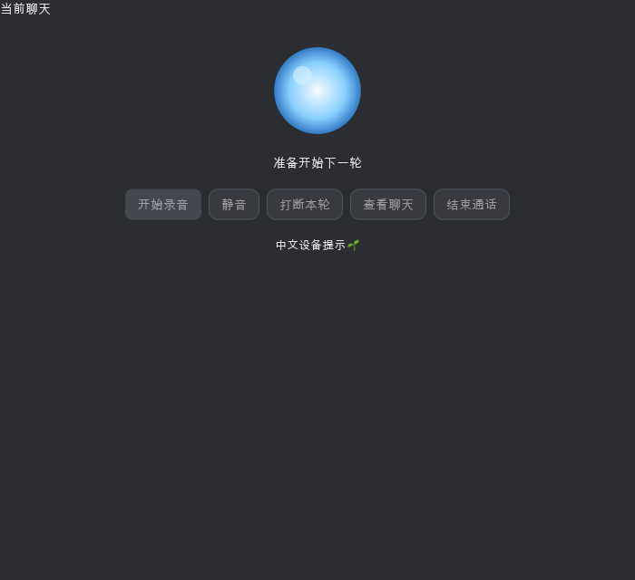

# Cargo 开发槽位与月亮组件实测

2026-11-13，macOS arm64。已统一 Cargo 中间产物与最终产物路径，加入同一开发阶段的槽位复用，并验证真实语音组件的 SVG、布局、状态文字与按钮事件。实测显示 Relax 可热更新这条组件路径；机器并发编译使部分 Cargo 样本失去可比性，本次不发布可靠提速倍率。

## 已落地的开发入口

- `.cargo/config.toml` 移除固定的 `build-dir = "target"`，让 Cargo 中间产物默认跟随目标目录；保留原有默认 `target-dir`，不迁移或删除缓存。
- `scripts/cargo_slot.py` 原子领取仓库共享的 1–20 号槽位，同时设置两个绝对路径环境变量；同一入口内的顺序命令和嵌套调用复用槽位。
- 入口核对旧计划记录的持有者 PID，可继承当前进程或祖先进程手工领取的槽位；不回收其它任务的锁。失败、中断和主进程先退出时，等待自有进程组停止后释放锁，保留缓存。
- Relax 脚本、metadata 和工具安装构建继承槽位；工具安装完成后复制运行器到版本化工具目录。三个 Cargo 别名不再覆盖调用者的 `--target-dir`。
- `AGENTS.md` 与构建说明加入默认使用方式。支持 macOS/Linux；本次实测为 macOS，Python 3.9。

同一阶段用一次入口包住顺序命令：

```sh
python3 scripts/cargo_slot.py sh -c '
  cargo check -p vw-desktop --lib &&
  cargo test -p vw-desktop --lib voice_task_11_ -- --test-threads=1 &&
  cargo clippy --all-targets --all-features -- -D warnings
'
```

开发命令仍可直接使用 `cargo dev-gateway` / `cargo dev-desktop`，Python 准备阶段及常驻 Relax 期间持有槽位。要将 Python 启动前的小型 Rust 启动器也纳入同一槽位，使用 `python3 scripts/cargo_slot.py cargo dev-desktop`。入口内仅运行前台任务，不启动脱离进程组的后台工作。

## 测量的真实改动

在当前工作区的隔离副本 `/tmp/shiju-cargo-moon-20261113/source` 修改真实生产组件 `voice_chat.rs::local_overlay`：将 640×760 弹窗改成保留底层聊天的紧凑纵向布局，新增蓝白渐变 SVG 球体，保留由录音阶段决定的开始/停止按钮及静音、打断、查看聊天、结束事件。随后反复将球体实际尺寸在 96px 与 100px 间切换，触发重新布局及绘制。

独立测试追加在 `voice_chat_tests.rs`，通过真实 Iced UserInterface 布局、Tiny-Skia 绘制和鼠标点击检查：

- Ready、Recording、Preparing 三个阶段；700×640 与 1280×800 两种尺寸；明暗主题，共 12 个绘制场景。
- 大弹窗标题消失，紧凑控件位于聊天下方，蓝色 SVG 实际产生像素。
- 中文、emoji 实际整形；开始/停止、静音、打断、结束事件正确，准备阶段开始按钮禁用。

生产工作区的语音文件与原计划状态保持原样；实验补丁没有作为完整月亮功能接入输入框，也不代表完成授权、物理音频、完整 App 或真人通话验收。补丁与测试可在[实验差异](evidence/cargo-moon-2026-11-13/moon-ui.patch)审查。




## 结果及适用范围

最终配色修正后的同一测试夹具，每次执行 1 个测试，内部覆盖 12 个绘制场景，9714 个其它测试被过滤。所有下列行为测试均通过。

| 场景 | 耗时 | 采样前 CPU 空闲率 | 使用方式 |
| --- | ---: | ---: | --- |
| Cargo：96→100px，样本 1 | 65.278 秒 | 75.81% | 单个达到采样前空闲阈值的观察值 |
| Cargo：100→96px，样本 2 | 55.974 秒 | 16.44% | 繁忙样本，排除安静条件对比 |
| Cargo：96→100px，样本 3 | 135.783 秒 | 0% | 繁忙样本，排除安静条件对比 |
| Relax 常驻：100→96px | 0.974 秒 | 未采集 | 探索性观察值 |
| Relax 常驻：96→100px | 0.752 秒 | 未采集 | 探索性观察值 |
| Relax 常驻：100→96px | 0.771 秒 | 未采集 | 探索性观察值 |

Relax 三次观察值中位数 0.771 秒；日志每次显示安装 1 个新函数，并重跑同一个测试，均为 `ran=1 passed=1 failed=0`。运行器父 PID 26335、执行测试的子 PID 26336 保持不变，未以重启代替热更新。首次可用时间 94.368 秒，包含原生依赖准备，单独记录，不计入热改耗时。

Cargo 对齐阶段首次预热 320.273 秒，单独排除。该阶段全部使用 `/Users/xiangmin/worker/code/shiju/target/rust-slot-3`，两个环境变量完全相同。Relax 阶段也使用该槽位，两个阶段顺序执行；原生样本之间一直持有同一锁。原生计时从保存后立即启动 Cargo 到命令结束；Relax 从保存前到轮询观察到通过 verdict，轮询间隔 100ms。

前期探索还记录了初始 SVG/布局补丁通过耗时 222.640 秒、无修改复跑 1.161 秒、几何调整 54.842 秒。截图审查后补齐测试夹具的主题文字色与背景，复测通过；配色修正后的无修改复跑为 0.732 秒。前期数字不与最终夹具混算倍率。最初旧弹窗在行为断言处真实失败；首次月亮补丁出现提示文本借用生命周期错误，经克隆提示文本修正，失败编译耗时不作为有效样本。

机器存在其它构建任务，原生后两轮未达到采样前空闲阈值，最终 Clippy 也与补测部分重叠；Relax 未采集配对的 CPU 空闲率，两个编译器的优化策略也不同。当前证据支持这条几何热改路径可用，不支持受控倍率、任意 UI 修改、类型/trait/依赖修改或首次全量构建的提速结论。

所有性能样本均在缓存路径统一后采集；本次没有对原有分离路径做完整 A/B 计时。缓存路径修复解决中间产物越过槽位的问题，不能将 Relax 的热更新收益归因于该配置修复。测试过滤只减少执行范围，仍要编译包含约 9700 个测试的完整 lib-test 目标，这是本轮原生反馈的主要成本。

## 验证与交接

- 槽位脚本 6 项、Relax 脚本 7 项、清理脚本 3 项，合计 16 项通过。包含真实子进程环境传递、退出码、中断清理、主进程先退出后的子进程清理、嵌套复用和父任务锁保留。
- 真实 Cargo 探针通过：仅设置 `CARGO_TARGET_DIR` 时，二进制与 `.fingerprint` 都落在槽位，临时项目未创建分离的 `target`。探针编译退出 0。
- 统一入口的 `cargo dev-setup` 与去掉新入口标记后的旧式持有者继承验证均退出 0。启动器独立 Clippy 退出 0。
- 整仓 Clippy 初次退出 0（46.91 秒）；最终复跑退出 101，在本次未修改的 `crates/vw-agent/src/gateway/api/handlers/session/agent_profile_acceptance_tests.rs:273` 遇到 E0603：调用私有的 `crate::agent::load_agent_configs`。没有修改该无关路径，初次成功不替代最终结果。
- 语音实验的 Cargo 聚焦测试均退出 0，Relax 初始及三次热改测试均给出通过 verdict；常驻运行器最后由脚本 SIGTERM 停止（进程退出码 -15）。未运行无过滤全量单元测试。

原始命令、槽位、逐轮耗时、退出码、源码 SHA、运行器 SHA、脚本归档及截图保存在 [evidence/cargo-moon-2026-11-13](evidence/cargo-moon-2026-11-13/)。首次安装完整构建尚未重新下载执行，已有固定版本安装的准备路径已验证。所有自有实验进程结束后释放自有锁，保留构建缓存，不清理其它任务资源。

下一步建议：日常保持 Relax 常驻，用统一入口执行同阶段包级检查与必要的聚焦测试；完成时保留整仓 Clippy。先修复上述无关编译错误，再在空闲机器补齐对齐样本；完整语音月亮计划继续按原任务的授权与实机验收要求执行。
