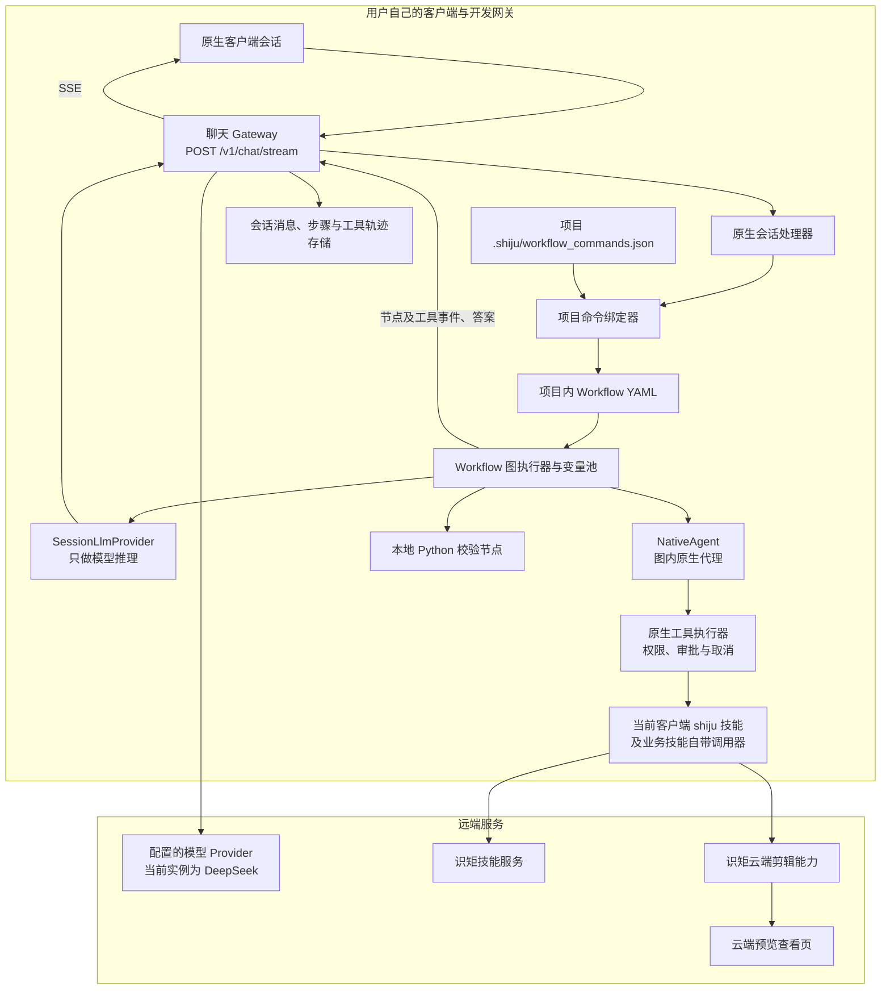
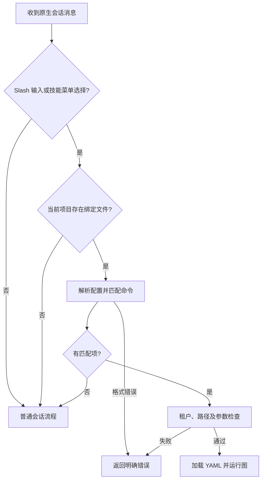
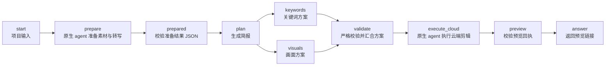
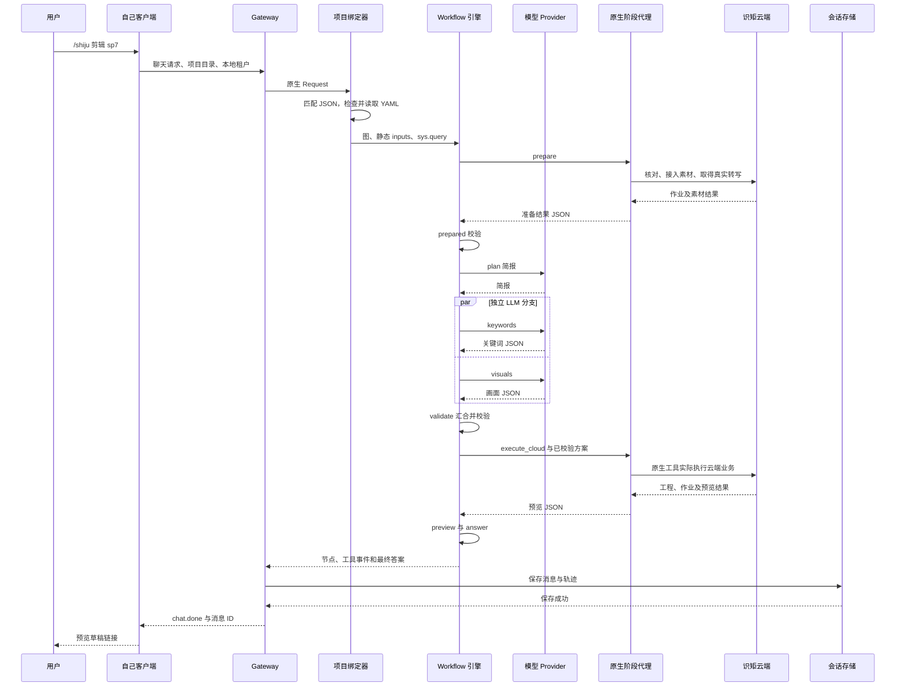

# 原生会话工作流与云端剪辑架构

本文说明截至 2026-11-04 的实现，区分通用机制、口播剪辑流程与 sp7 的开发配置。代码定位见末尾索引；实机证据见[原生会话命令绑定与验收记录](workflow/原生会话命令绑定.md)。

**通用的是原生会话的命令绑定机制和 YAML 图执行器。当前剪辑 YAML 面向口播场景；sp7 是其中一个已配置的项目实例。系统尚未实现“任意会话输入任意项目名，就自动找原片、选择工作流、创建云端工程”的全局入口。**

此前“打开 sp7 会话输入 `/shiju 剪辑 sp7` 就能运行”的结论，适用于已配置的 sp7 项目及支持此能力的开发网关，不能扩展成所有项目天然可用。

## 1. 哪些部分通用，哪些部分需要配置

| 层次 | 当前职责 | 通用程度 |
| --- | --- | --- |
| 原生聊天入口 | 接收消息、确定项目目录与租户、建立流与取消句柄 | 通用 |
| 命令绑定器 | 将项目内配置的 slash 命令映射到 YAML 与输入参数 | 通用，但必须显式配置 |
| 工作流引擎 | 解析图、调度节点、传递变量、处理分支和结果 | 通用，不识别 sp7 业务含义 |
| 原生运行时适配器 | 给图提供当前会话的模型、工具及 agent 执行能力 | 通用适配层，有明确能力边界 |
| 口播云端剪辑 YAML | 准备转写、生成和校验方案、执行云端剪辑、返回预览 | 面向口播剪辑的业务流程 |
| sp7 项目配置 | 指定原片、云端工程、客户端技能目录、风格和模型 | 项目实例配置 |
| 识矩云端 | 保存素材和工程，执行媒体处理、包装与预览作业 | 远端业务能力，由账号授权决定 |

因此，其他业务可以复用命令绑定器与执行器，也可以编写其他 YAML；其他口播视频可以复用这份剪辑图，但仍需提供正确的项目输入。旅游混剪、直播切片等不同业务，不能仅靠替换文件名就视为已支持。

## 2. 总体架构



图中的本地部分承担调度、模型调用、文件字节上传和数据校验。视频转写、媒体生成、剪辑合成与预览由云端业务能力执行。本地 Python 校验 JSON 与本机加工视频是两种不同工作；当前流程没有用本机 FFmpeg 代剪。

Dify YAML 在这里是图描述格式，由仓库自己的 Rust 执行器解释；不要求另起一个 Dify 服务。运行时也不依赖 Codex 发出下一步编辑指令。

## 3. 它怎样知道应该调用工作流

### 3.1 根据项目配置确定性匹配

原生处理器在进入普通模型循环前调用 `run_bound_command`：

1. 读取当前会话的 `Request.root`，得到项目目录。
2. 读取该目录下的 `.shiju/workflow_commands.json`。
3. 提取用户输入的 slash 命令，或解析客户端技能菜单附带的选择上下文。
4. 按前缀和词边界匹配 `commands[].command`；有多个匹配时优先最长命令。
5. 核对绑定的本地平台、公司与当前租户相同。
6. 加载项目内 YAML，构造 `WorkflowRunRequest`，直接进入图执行器。
7. 没有配置或没有命中的命令时，继续普通会话处理。

**命中绑定后，不需要先问一个大模型“要不要使用工作流”。** 未命中时，也不能据此保证普通代理一定会使用相同工作流。



### 3.2 两种客户端输入方式

- 直接输入 `/shiju 剪辑 sp7`。
- 从菜单选择 `shiju` 技能，再输入 `剪辑 sp7`。客户端可能移除输入框里的 `/shiju`，并通过 `session_control_selection` 附带 `技能：shiju`；绑定器会按现有协议还原匹配上下文。

`/shiju` 技能菜单、名为 shiju 的技能包、`/shiju 剪辑` 命令绑定，以及工具描述中的 `provider: shiju`，分别属于 UI 选择、技能发现、命令路由和原生工具适配，不是同一个注册动作。只安装技能，不会自动生成项目工作流绑定。

### 3.3 sp7 这个名字目前不负责解析文件

当前绑定前缀是 `/shiju 剪辑`，原片来自配置中的 `source_file`。

| 输入和所在项目 | 当前含义 |
| --- | --- |
| sp7 项目中输入 `/shiju 剪辑 sp7` | 匹配绑定，读取配置里的原片和工程 |
| 同一项目中输入 `/shiju 剪辑 sp8` | 仍会匹配同一前缀，不会自动把 source_file 改成 sp8 |
| 无绑定的另一个项目输入相同命令 | 不会自动获得 sp7 的绑定；进入普通会话逻辑 |
| 输入 `/shiju 登录` | 不匹配当前剪辑绑定 |
| 普通输入“帮我剪辑 sp7”，未选择技能菜单 | 不走当前 slash 绑定分派 |

绑定器不递归搜索其他目录或替用户识别视频项目名。后续正文作为工作流的 `sys.query` 可用，但必须由 YAML 明确引用，才会影响相应节点。

## 4. 项目配置和参数如何传入

项目结构：

```text
<project>/
├── 原始视频.mov
├── AGENTS.md
├── .shiju/
│   ├── workflow_commands.json
│   ├── workflows/
│   │   └── talking_head_cloud.yaml
│   └── workflow_acceptance.json
└── .shiju-video/
    ├── prepared.json
    └── .occ-state.json
```

`workflow_commands.json` 的结构示例：

```json
{
  "platform_id": "10000",
  "company_id": "100000000",
  "commands": [{
    "command": "/shiju 剪辑",
    "workflow_file": ".shiju/workflows/talking_head_cloud.yaml",
    "inputs": {
      "source_file": "/absolute/path/to/project/原始视频.mov",
      "shiju_skill_root": "/absolute/path/to/client/skills/shiju",
      "cloud_project_id": "已确认归属的云端工程 ID",
      "style": "简洁清晰的产品讲解风格",
      "requirements": "保留真实原声，精剪并添加字幕及适量包装，先交预览"
    }
  }]
}
```

| 数据 | 来源 | 作用 |
| --- | --- | --- |
| `platform_id` / `company_id` | 绑定配置与当前请求租户 | 限定本地绑定适用范围 |
| `workflow_file` | 项目绑定 | 指定要执行的图，而非让模型猜测 |
| `project_directory` | 绑定器注入规范化后的真实项目路径 | 节点工作目录；覆盖同名静态输入 |
| `source_file` | 静态 inputs | 本次原片；当前没有命令尾部文件名解析器 |
| `shiju_skill_root` | 静态 inputs | 使用自己客户端的技能实例与现有认证 |
| `cloud_project_id` | 静态 inputs | 复用用户已选空间内的工程 |
| `style` / `requirements` | 静态 inputs | 方案生成的业务要求 |
| `sys.query` | 本轮匹配后的完整请求 | 自由文本补充；需要节点模板引用 |
| 节点输出 | 执行器变量池 | 供下游 selector 和模板读取 |

模板 `{{#prepared.transcript#}}` 引用准备节点输出；代码节点可通过 `value_selector: [prepared, transcript]` 绑定入参。`sys.query` 是系统变量，不会自动覆盖 source_file 等静态输入。

本地租户与云端账号是两层身份：本地使用开发租户 `10000 / 100000000`，云端权限以客户端已有识矩登录和实际空间授权为准，不能把本地公司 ID 冒充云端公司 ID。

`AGENTS.md` 提供执行约定；实际路由依据是 JSON 绑定文件。仓库样例与项目 YAML 是两份文件，复制后不会自动同步更新。

### 4.1 配置检查与执行权限的边界

绑定器拒绝未知配置字段；绑定 JSON 上限为 64 KiB，YAML 上限为 1 MiB。YAML 规范化后的路径必须位于当前项目内；输入键不能使用 `__vw_` 运行时保留前缀。原生绑定为图设置的执行步数上限是 200；云端样例分别为 prepare、execute_cloud 设置 100、180 次 agent 迭代上限。

上述路径检查约束的是工作流文件，不是对所有输入路径的统一沙箱。agent 的文件和命令行为仍受原生工具执行策略约束；YAML 中的代码节点属于本地可执行代码，也不能因文件位于项目内就视为安全隔离。绑定与 YAML 应作为需要审查的可执行项目配置管理。

## 5. 当前口播剪辑图的完整流程



| 节点 | 类型 | 输入与职责 | 输出或失败边界 |
| --- | --- | --- | --- |
| start | start | 接收项目、原片、工程及业务要求 | 起始变量 |
| prepare | agent | 按当前客户端技能生命周期，核对工程、上传或复用素材、取得云端真实转写 | 工程 ID、素材 ID、全文、逐词时间戳；不能编造 |
| prepared | code | 解析原始 JSON，检查工程一致、素材 ID 与转写非空、时间戳列表非空 | 标准化输出；格式错误直接失败 |
| plan | llm | 根据真实转写、风格和要求生成简报 | 简报文本 |
| keywords | llm | 根据简报和时间戳生成关键词片段 | JSON 数组 |
| visuals | llm | 根据简报和时间戳生成画面建议 | JSON 数组，覆盖业务要求的画面类型 |
| validate | code | 汇合两支，检查锚点、时间和素材描述等约束 | 通过校验的计划 JSON；失败不进入云端执行 |
| execute_cloud | agent | 将已校验方案作为依据，通过业务技能调用真实云端能力 | 实际预览回执，而非文字建议 |
| preview | code | 检查工程一致、ready 标记及查看页 URL 结构 | 可用于答案的 URL；失败不报成功 |
| answer | answer | 组装最终预览回复 | 预览草稿链接，等待用户确认导出 |

当前引擎只有就绪节点均为 `llm` 时才组成并行批次。本图并行的是 keywords 与 visuals；validate 等两支结束后运行。不能由此推导所有 agent、工具或有副作用节点都允许并发。

### 5.1 方案校验具体检查什么

当前代码检查时间戳为非空列表、时间为有限数值且区间有效；片段时间不能越过转写时长；anchor 必须是原文连续子串；assets 必须为非空、非空白字符串描述数组；结果必须覆盖 keyword、b_roll、motion_graphic 三种类型。

它不等于完整剪辑质量证明：不保证每个片段精确对齐某个词的边界，不检查所有片段互不重叠，也不把“素材描述”认定为已生成素材。资产生成和实际放置由后续云端节点完成。

### 5.2 预览校验的实际强度

preview 代码节点检查的是 agent 返回的 JSON：项目 ID、`preview_ready: true`、HTTPS URL 和 `/s/` 路径。**该代码节点本身没有独立访问云端核验状态，也没有自动打开浏览器检查播放。** 云端回读和业务检查由 execute_cloud 里的原生 agent 完成。

sp7 本轮验收额外做了独立云端回读和浏览器实际播放；这证明本次结果可播放，不代表每次运行都会自动执行同样的浏览器探测。若产品要求硬性的自动交付保证，需要补充确定性的云端状态和媒体可播放性校验。

## 6. LLM 节点和 agent 节点的区别

### 6.1 LLM：单次推理，由图决定后续步骤

plan、keywords、visuals 通过 `SessionLlmProvider` 走已有 Gateway 模型通道，内部请求禁用隐式工具执行。模型返回文本或 JSON，由图继续传递和校验；它不会自行跨过 validate 去编辑云端。

Provider 会分离正文和推理块，避免 `<think>` 混入严格 JSON。支持交错推理的兼容 Chat 模型，还需要在实际 HTTP 工具历史中保留声明的推理字段；这些属于模型传输层职责。

### 6.2 Agent：图内受约束的原生工具循环

prepare 和 execute_cloud 通过 `NativeAgent` 适配器执行：

1. 检查节点工具声明及父会话允许范围。
2. 从父 Request 复制项目、相关选项、权限和取消关系。
3. 创建 `workflow-stage-*` 临时原生阶段会话，使用节点明确指定的模型。
4. 以节点渲染后的消息作为阶段上下文，不直接带入父会话全部历史。
5. 调用自己客户端已有的 `session::runtime::start_prompt`，执行正常原生模型与工具循环。
6. 回传真实工具事件，限制阶段迭代次数，最终将末轮可见答案交还图。

因此，云端 agent 节点内部仍使用模型提示词和动态工具选择。图固定了阶段、依赖及校验门槛；它没有把每一个上传、素材生成和云端剪辑调用都展开成独立的确定性 YAML 节点。

**“工作流在执行”与“工作流包含 agent 节点”可以同时成立。当前执行剪辑的是工作流里的 DeepSeek 原生代理，不是 Codex 会话在替它逐次发出编辑调用。** Codex 在本轮承担实现、配置、触发测试及只读验收工作。

### 6.3 模型如何选

节点显式配置的 `data.model.name` 优先；未配置时使用运行时提供的默认模型。sp7 的五个模型节点目前均指定 `deepseek/deepseek-flash`。

只在客户端切换聊天模型，不会自动覆盖 YAML 中的显式模型。复制样例时应检查五个节点，而不是只改一个节点或仅改全局默认模型。

## 7. 原生代理如何接到识矩云端

当前适配链为：

```text
Workflow agent 节点
  → 自己客户端的原生会话运行时
  → 原生 bash / 文件工具
  → 当前客户端 shiju 技能发现与生命周期
  → 取得已安装识矩剪辑业务技能
  → 业务技能自带 occ.py 调用器
  → 识矩云端 MCP 接口及异步作业
  → 工程、素材和预览回执
```

当前样例使用已安装的 skill_id=405。该 ID 属于这个业务配置，Rust 命令分派器并没有把所有命令都固定为技能 405。

本地运行调用器时，`OCC_SHIJU_ENV` 指向客户端已有认证配置，`OCC_STATE_DIR` 指向项目状态目录；配置只写凭据文件的位置，不写密钥。调用器承担业务传输，本地只上传已存在的原片字节，不转码。

当前没有专门实现一个 Rust `cutvideo` 强类型工具，直接将全部剪辑 schema 暴露成原生 Workflow tool 节点。现有 NativeTools 是对客户端原生工具执行器的适配；云端业务接口的细分调用由图内 agent 按当前业务技能合同发起。业务模板仅在执行上下文中使用，本文不复制其内容。

## 8. 一次调用的时序



图表示成功路径。任何步骤失败都不能用“请求 HTTP 200”替代成功判断；还要观察流终态与保存结果。

## 9. 事件、结果与会话保存

| 事件或数据 | 当前处理 |
| --- | --- |
| WorkflowStarted | 建立工作流运行 ID |
| NodeStarted / NodeFinished | 转为原生 `chat.tool`，工具名为 workflow |
| 节点事件 payload | 运行 ID、节点 ID、标题及耗时等，不附带整个节点输入 |
| 阶段代理工具事件 | 通过现有原生工具事件回传到父会话 |
| 成功答案 | 图成功后发出最终文本，经过 Gateway 保存后返回 `chat.done` |
| 错误或取消 | 发出 `chat.error`，不返回成功终态 |
| 工作流容器步骤 | 保存步骤与工具计时，finish_reason 为 workflow，model 为空 |

工作流容器步骤本身不是一轮 LLM 请求，不应伪造原始 LLM 产物。网关已经修复这一差异；真正的 LLM 步骤仍需满足原始产物提交检查。

当前容器级 TokenUsage 没有汇总所有嵌套模型调用，零值不能解释成没有 token 消耗。用户能看到工具和节点轨迹，也不等于拥有可持久化恢复的完整图检查点。

## 10. 状态、缓存与失败后的行为

| 位置 | 性质 | 能否作为完成依据 |
| --- | --- | --- |
| 仓库样例 YAML | 可复制的业务流程模板 | 不能证明某次执行完成 |
| 项目绑定及 YAML | 下一次请求读取的执行配置 | 决定路由和流程，不是云端状态 |
| `.shiju-video/prepared.json` | 真实素材准备结果的本地缓存 | 需回读云端核对，不应直接盲信 |
| `.shiju-video/.occ-state.json` | 调用器当前工程绑定等状态 | 不能代替云端工程状态 |
| 云端工程及作业 | 实际素材、剪辑和媒体处理结果 | 业务事实来源 |
| 原生会话存储 | 用户消息、答案、步骤与工具轨迹 | 证明回传及保存，不单独证明视频可播放 |
| `.shiju/workflow_acceptance.json` | 本轮测试写入的辅助验收记录 | 不是引擎自动创建的检查点或调度依据 |

一次运行开始后使用已读取的图；修改配置影响后续请求，不会自动修改正在运行的图。

当前原生运行时没有配置 `pause_store`。重新输入命令会创建新运行，不是引擎从上次失败节点精准恢复。复用素材、转写和已有预览，依靠业务节点先回读再续做；它不是通用的持久化断点恢复或 exactly-once 保障。

取消会传播到图和阶段代理的本地执行，但不能据此承诺已提交的云端作业全部取消，也没有自动回滚已发生云端写入的能力。重试时必须先核对远端结果。

| 失败 | 当前处理原则 |
| --- | --- |
| 绑定文件、租户或 YAML 路径错误 | 明确失败，不静默切换到另一个工作流 |
| 显式节点模型不可用、额度不足 | 报错；不会自动替换成另一个账号或模型 |
| 分支 JSON、锚点或时间不合法 | validate 失败，不进入 execute_cloud |
| 云端工具局部调用失败 | agent 可依照回执修正或续查；阶段最终未满足合同则不能报成功 |
| 只有空工程或查看页链接 | 不等于已经剪辑，更不等于可播放预览 |
| 云端已完成但消息保存失败 | 用户交付仍未完成，需要修复回传并复验 |

sp7 项目在续验时让云端节点引用 `sys.query`，识别“复用已完成预览、不要重复修改时间线”的明确要求。这是项目 YAML 的业务约定，不是全局命令解析器自动提供的恢复能力。

## 11. 不同执行入口的能力不能混为一谈

| 入口 | 图来源 | 当前 agent 运行能力 |
| --- | --- | --- |
| 原生会话 slash 绑定 | 项目内 YAML 文件 | 构造 NativeAgent 与 NativeTools，支持当前剪辑图 |
| 工作流应用 API | 保存的应用或请求体 YAML | 当前 `workflow_runtime` 的 agent_provider 为 None；不能直接等同于原生入口 |
| 普通技能会话 | 代理按技能内容自行执行 | 可能使用业务能力，但不代表经过这份图和校验门槛 |

保存一个 Workflow 应用，不会自动为每个项目注册 `/shiju 剪辑`。相同 YAML 含 agent 节点时，应用 API 若没有对应 provider 会明确失败。

引擎支持的节点类型也不等于每个入口都注入了全部依赖：原生绑定未配置 knowledge_provider、document_extractor、pause_store；agent 当前仅支持 function_calling 策略。不能把 Dify 文件格式兼容理解为支持任意 Dify 应用及插件。

## 12. 换视频或换业务，怎样复用

### 12.1 换另一个口播项目

1. 在自己的客户端打开目标项目目录。
2. 将口播云端 YAML 放入该项目，并建立该项目的绑定文件。
3. 明确原片 `source_file`，确认云端空间及工程，再配置 cloud_project_id。
4. 填入这个客户端实际使用的 shiju 技能目录，确认业务技能已授权。
5. 检查五个模型节点，使用已连接且可调用的模型，或按需求使用运行时默认模型。
6. 按原片要求填写风格与 requirements，再从该项目会话输入绑定的命令。
7. 验收实际预览和会话保存结果，确认后再走导出流程。

当前云端样例要求复用一个预先确认的工程，不会仅凭绑定输入缺失就自动创建工程或替用户选择品牌空间。

同一目录需要多个固定输入时，可以配置多个显式命令绑定，例如 `/shiju 剪辑 sp7` 与 `/shiju 剪辑 sp8`，分别填入输入；最长前缀匹配机制可复用，但这仍是配置映射，不是自然语言参数解析。

### 12.2 换其他业务流程

编写另一份 YAML，沿用已有节点和变量约定；绑定到新的 slash 命令。原生适配器不需要知道它叫口播剪辑、报告生成还是其他业务，但流程依赖的工具、模型与权限必须真实可用。需要当前运行时未注入的 provider 时，应显式补齐适配，不能以提示词假装已支持。

## 13. 若要做成产品级通用入口，还缺哪些部分

以下是基于当前边界的后续设计方向，**不是已实现的能力，也不是本次新增接口**。

| 缺口 | 建议职责 |
| --- | --- |
| 用户意图与流程选择 | 提供显式流程选择；需要智能推荐时先产出可核对的选择结果，再执行 |
| 原片与参数解析 | 将用户选中文件或明确路径解析为结构化输入，避免把项目名当文件路径 |
| 工作流注册与版本 | 统一管理业务流程 ID、版本、输入 schema 与项目绑定，减少手动复制漂移 |
| 工程与空间配置 | 将用户确认的云端归属及工程准备变成明确阶段，避免隐含使用某个空间 |
| 云端能力的确定性适配 | 对稳定的业务调用实现强类型 provider，使关键检查和失败处理不只依赖 agent 判断 |
| 自动交付校验 | 独立核对工程、素材、作业结果和媒体可播放性，而非只检查模型返回的 ready 布尔值 |
| 恢复与幂等 | 持久化图检查点和云端作业关联；恢复先对账，避免重复上传、重复生成和重复写入 |
| 入口一致性 | 明确原生会话与工作流应用 API 的 provider 合同，并用真实调用验收 |
| 可观测性 | 聚合嵌套模型用量、阶段耗时及远端作业状态，保持凭据与业务模板的边界 |

当前接线解决了“原生会话能确定触发图，并由图驱动真实云端剪辑及回传”的闭环；它尚未完成上述通用业务入口的全部产品化工作。

## 14. 代码与文档索引

| 模块 | 位置 |
| --- | --- |
| 原生分派插入点 | [session/processor/runner.rs](../crates/vw-agent/src/session/processor/runner.rs) |
| 项目绑定、图运行和事件转换 | [workflow/native.rs](../crates/vw-agent/src/workflow/native.rs) |
| 原生 agent 与工具适配 | [workflow/native_agent.rs](../crates/vw-agent/src/workflow/native_agent.rs) |
| 图调度、节点分派、变量初始化 | [workflow/runner.rs](../crates/vw-agent/src/workflow/runner.rs) |
| YAML 解析 | [workflow/model.rs](../crates/vw-agent/src/workflow/model.rs) |
| 模板及变量池 | [template.rs](../crates/vw-agent/src/workflow/template.rs)、[variables.rs](../crates/vw-agent/src/workflow/variables.rs) |
| 本地代码节点 | [code_runner.rs](../crates/vw-agent/src/workflow/code_runner.rs) |
| LLM Gateway 适配 | [providers/session_llm.rs](../crates/vw-agent/src/providers/session_llm.rs) |
| 普通工作流应用 API 的 runtime | [handlers/workflow.rs](../crates/vw-agent/src/gateway/api/handlers/workflow.rs) |
| 聊天流、持久化及完成终态 | [session/stream.rs](../crates/vw-agent/src/gateway/api/handlers/session/stream.rs) |
| 云端口播样例 | [talking_head_cloud.yaml](../crates/vw-agent/testdata/workflow/talking_head_cloud.yaml) |
| 原生绑定回归 | [native_tests.rs](../crates/vw-agent/src/workflow/native_tests.rs) |
| Gateway 集成与轨迹回归 | [stream_tests.rs](../crates/vw-agent/src/gateway/api/handlers/session/stream_tests.rs) |
| 配置与历史实机记录 | [原生会话命令绑定](workflow/原生会话命令绑定.md) |
| 只生成方案的原始样例 | [口播样例](workflow/口播样例.md) |

本文描述当前架构，不包含云端私有业务模板、原片内容、原始转写、凭据或预览访问令牌。
